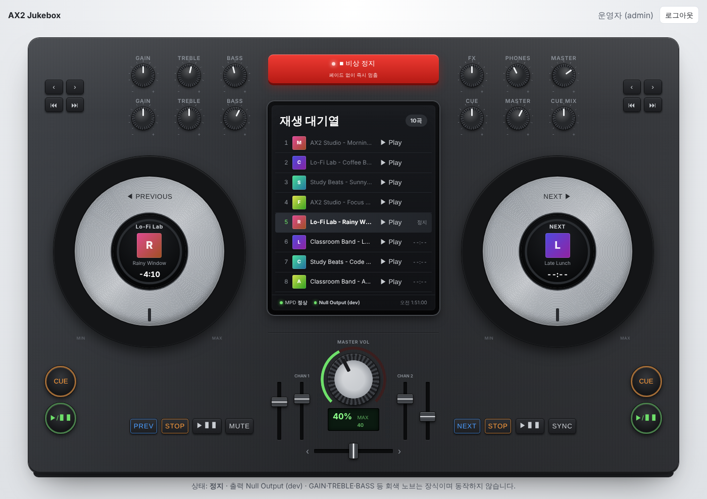
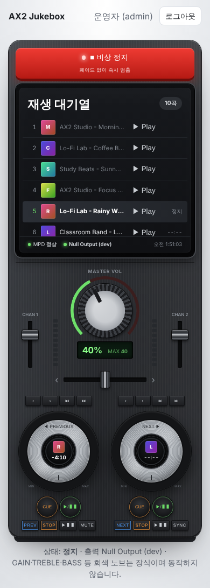

# STEP 01 결과 보고 — Ubuntu 오디오 출력 + MPD 연결 검증

- 일자: 2026-10-20
- 범위: 요구사항 15장 STEP 01 (1–6번)
- 검증 환경: 개발 컨테이너(Ubuntu 24.04, Python 3.13, PostgreSQL 16, MPD null 출력). **실제 사운드 장치 없음.**

## 1. 구현 내용

| 항목 | 내용 | 위치 |
|---|---|---|
| Player Controller | MPD 단일 연결·락 직렬화, 끊기면 1회 재연결, 상태 조회, 재생/일시정지/이어재생/정지/다음/볼륨/음소거/비상 정지 | `backend/app/services/player.py` |
| 볼륨 상한 | 요청값을 `max_volume`(기본 40)으로 자르고 `clamped` 반환. **재생·이어 재생 직전에도 상한 초과 볼륨을 낮춤** | 같은 파일 `_enforce_cap` |
| 인증 | 아이디/비밀번호 로그인(argon2id), 5회 실패 10분 잠금, 서버 측 세션(토큰 해시 저장), CSRF 헤더 검증 | `backend/app/auth/`, `app/api/auth.py` |
| 관리자 CLI | `create / promote / revoke / reset-password / list`, 마지막 관리자 회수 방지, 감사 로그 | `backend/app/cli.py`, `scripts/jukebox-admin` |
| API | `POST /api/auth/login·logout`, `GET /api/auth/me`, `GET /api/player/status`, `POST /api/player/control`, `POST /api/player/emergency-stop`, `GET /health/live·ready` | `backend/app/api/` |
| 관리자 화면 | **DJ 컨트롤러 형태의 운영 콘솔**(7절). 비상 정지, 현재/다음 곡 덱, 대기열 화면, 볼륨 노브, 음소거, MPD·출력·오류 상태, 3초 폴링. 외부 CDN 없음(인터넷 없이 동작) | `backend/app/templates/admin.html`, `app/static/deck.css`, `app/static/admin.js` |
| DB | `users`, `sessions`, `control_audit_logs`, `system_settings` + Alembic 초기 마이그레이션 | `backend/app/models/`, `backend/migrations/` |
| 배포 | MPD 설정(127.0.0.1 바인딩, `restore_paused`), systemd 유닛(워커 1개) | `deploy/` |

## 2. 자동화 테스트 — 63개 PASS

```
$ cd backend && uv run pytest -q
63 passed in 13.6s
```

| 파일 | 개수 | 주요 검증 |
|---|---|---|
| `test_player_api.py` | 32 | 재생 흐름, 볼륨 80→40 클램프(수용 테스트 4), 학생 제어 403(수용 테스트 10), CSRF 누락 403, 빈 대기열 409, MPD 중단 시 503·상태 표시, 재연결, 감사 로그, 재생 직전 상한 강제, 대기열 조회, `play_at`·`previous` |
| `test_auth.py` | 12 | HttpOnly 쿠키, 토큰 해시 저장, 존재하지 않는 아이디와 틀린 비밀번호 응답 동일, 5회 잠금·해제, 비활성 계정 차단, 세션 만료, CSRF 안정성 |
| `test_cli.py` | 11 | 관리자 생성·비밀번호 규칙·중복·아이디 규칙, 승격 시 세션 폐기, 마지막 관리자 보호, 학생 비밀번호는 CLI 재설정 불가 |
| `test_player_controller.py` | 7 | 끊긴 연결 투명 재시도, 연결 재사용, 음소거 중복·복원, 믹서 없는 출력 |
| `test_mpd_integration.py` | 1 | **실제 mpd 데몬**(null 출력)으로 재생→일시정지→이어재생→볼륨 클램프→음소거→다음 곡→비상 정지 |

## 3. 수동 검증 (개발 컨테이너)

| 시나리오 | 결과 |
|---|---|
| `scripts/mpd-smoke-test.sh` (mpc로 재생/일시정지/볼륨/다음/정지) | PASS |
| 미인증으로 `/admin` 접속 → `/login` 이동 | PASS |
| 틀린 비밀번호 → 오류 메시지 | PASS ([캡처](images/step-01/01-login-error.png)) |
| 로그인 → 대시보드, MPD 연결 "정상" | PASS |
| MPD 볼륨 100% 상태에서 재생 → 40%로 내려간 뒤 재생 | PASS |
| 볼륨 80 요청 → `applied=40, clamped=true` / 슬라이더 25 → 25% | PASS |
| 일시정지 → 이어 재생 → 다음 곡 → 음소거(0%) → 해제 | PASS |
| 비상 정지 → "정지" | PASS |
| MPD 프로세스 종료 → status `connected=false, MPD_UNAVAILABLE`, 제어 503, `/health/ready` 503 | PASS |
| MPD 재시작 → 다음 조회에서 자동 재연결 | PASS |

## 4. 발견한 문제와 조치

| 문제 | 조치 |
|---|---|
| MPD는 기본 볼륨 100%로 시작해, 상한 40%를 설정해도 첫 재생이 100%로 나갈 수 있었음 | 재생·이어 재생 직전에 상한 초과 볼륨을 낮추도록 수정, 테스트 추가 |
| CSRF 토큰을 `/me` 호출마다 새로 발급하면 관리자 화면을 두 탭에서 열 때 먼저 연 탭이 실패 | 세션 토큰에서 파생하는 고정 CSRF 토큰으로 변경 |
| 개발 MPD 로그에 Avahi(zeroconf) 오류 | MPD 설정에 `zeroconf_enabled "no"` 추가 |

## 5. 현장에서 남은 확인 (강의실 서버)

컨테이너에는 사운드 장치가 없으므로 아래는 **미검증**이다. 절차는 [ubuntu-audio-setup.md](ubuntu-audio-setup.md).

- [ ] Ubuntu 버전, `aplay -l` 출력 장치, 앰프 연결 방식 확정
- [ ] 30초 테스트 음원으로 OS 레벨 재생(앰프에서 소리 확인)
- [ ] MPD ALSA 출력 `device` 지정 후 `scripts/mpd-smoke-test.sh` PASS
- [ ] PipeWire/PulseAudio 장치 점유 충돌 여부
- [ ] 웹 상한 40%에서 앰프 노브 현장 보정
- [ ] USB DAC 분리·MPD 중단·재부팅 시 대시보드 표시 확인

## 6. 범위 밖으로 넘긴 것

- 대기열 구성은 아직 `mpc add` 로 수동 → 플레이리스트·음원 등록 단계에서 앱이 관리
- 회원가입·가입 승인·학생 화면 → STEP 02
- `resume_schedule`, 페이드, 스케줄러 → STEP 03
- 로그인 rate limit(IP 기준) → STEP 02에서 회원가입과 함께
- 음소거 상태는 프로세스 메모리에만 있음. 앱이 재시작되면 볼륨 0이 유지되고 "음소거" 표시는 해제됨(소리가 커지는 방향의 위험은 없음)

## 7. 운영 콘솔 UI (DJ 컨트롤러 형태)

외부 3D/JS 라이브러리 없이 CSS(그라데이션·conic/radial 패턴·컨테이너 단위)와 순수 JS로 그렸다. 인터넷 없이 같은 Wi-Fi에서 동작해야 하고(NFR-002), 위에서 내려다본 평면 구도라 3D 엔진이 필요 없으며, 글자·버튼이 선명하고 키보드·스크린리더로 조작할 수 있기 때문이다.

| 하드웨어 요소 | 기능 |
|---|---|
| 비상 정지(빨간 버튼) | `POST /api/player/emergency-stop` |
| 가운데 화면 | 재생 대기열, 행별 `▶ Play`(`play_at`), 예상 시작 시각, MPD·출력 상태 LED, 오류 표시 |
| 왼쪽 조그 휠 | 현재 곡(아트·남은 시간·진행 링). 재생 중에만 회전 |
| 오른쪽 조그 휠 | 다음 곡과 예상 시작 시각 |
| ◀ PREVIOUS / NEXT ▶, ⏮ ⏭, PREV/NEXT 패드 | `previous` / `next` |
| ‹ › 패드 | 대기열 목록 스크롤 |
| 큰 ▶/❚❚ (왼쪽) · ▶❚❚ 패드 | 재생 / 일시정지 / 이어 재생 토글 |
| 큰 ▶/❚❚ (오른쪽) | 다음 곡 |
| CUE · STOP 패드 | 정지 |
| MASTER VOL 노브 | 볼륨. 위아래 드래그·휠·방향키(PageUp/Down ±5, Home/End). 상한 이후 구간은 어둡게 표시, `role="slider"` |
| MUTE 패드 | 음소거/해제(켜지면 빨간색 + "MUTED") |
| SYNC 패드 | 상태·대기열 즉시 새로고침 |
| GAIN·TREBLE·BASS 등 노브, 채널 페이더, 크로스페이더 | **장식**(MPD에 대응 기능 없음). 화면 하단에 명시 |
| 레벨 미터 | 재생 중임을 보여주는 표시등(실제 음량 측정 아님) |

수동 검증(헤드리스 Chromium): 목록 5번 Play → 현재 곡 전환·조그 회전, 토글로 일시정지 시 회전 멈춤, PREVIOUS/NEXT, 노브 End→↓↓ = 38%, 위로 크게 드래그해도 40%(상한), MUTE → 0% → 해제 40%, 비상 정지 → 정지. 페이지 오류 없음. 1400px·390px 폭 모두 가로 스크롤 없음.

| 데스크톱 | 휴대폰 |
|---|---|
|  |  |
