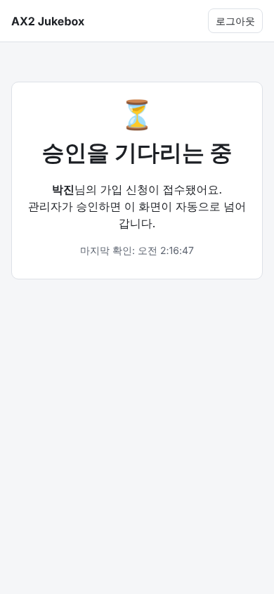
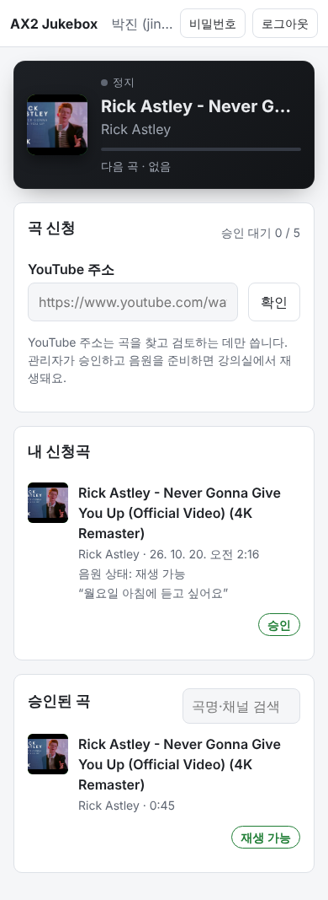
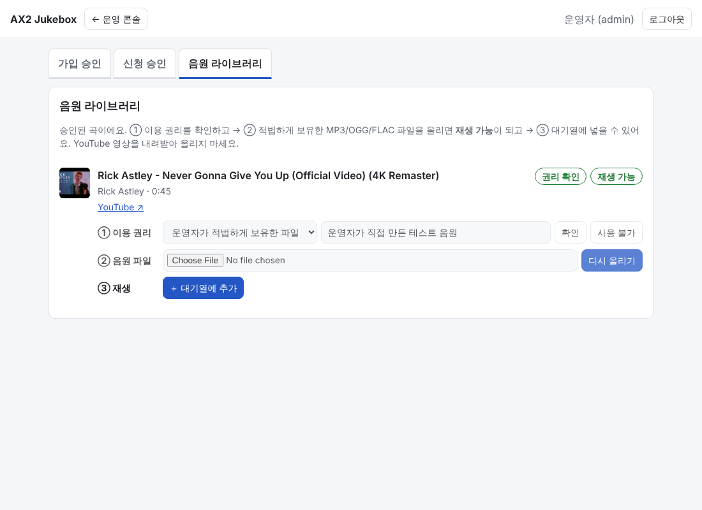
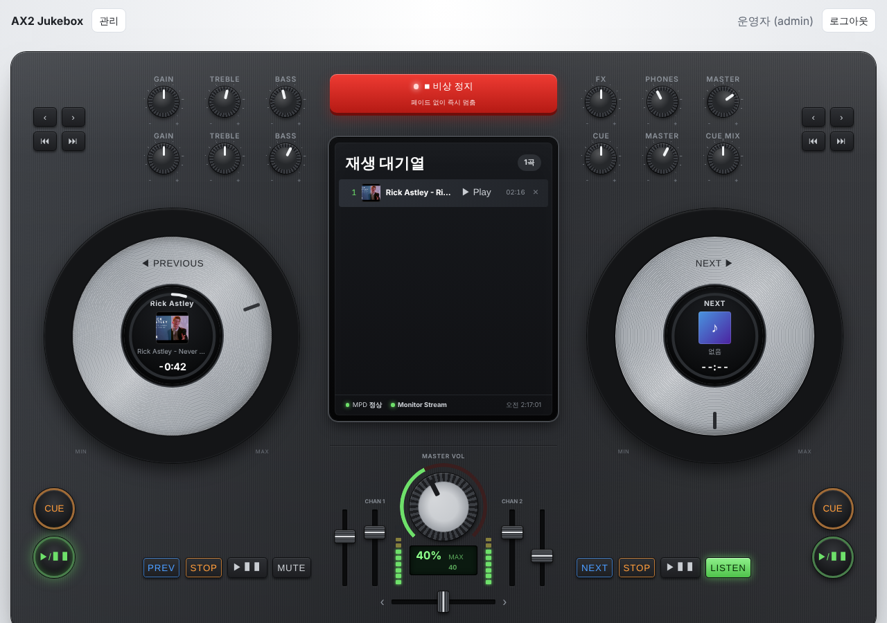

# STEP 02 결과 보고 — 회원가입·가입 승인·곡 신청·음원 등록 + Docker

- 일자: 2026-10-20
- 범위: 요구사항 11장 2단계(계정/권한, URL 신청, 메타데이터, 승인/반려/취소) + 노트북 테스트를 위한 음원 등록·대기열·Docker 구성
- 검증 환경: 개발 컨테이너에서 `docker compose` 로 PostgreSQL 16·MPD(httpd 출력)·앱을 띄워 헤드리스 Chromium으로 전체 흐름 실행

## 1. 구현 내용

| 영역 | 내용 |
|---|---|
| 회원가입 | 아이디·이름·비밀번호·가입 메모 → `PENDING_APPROVAL`, 가입 직후 승인 대기 화면(10초마다 자동 확인). 회원가입 열기/닫기, 승인 대기 상한, IP별 가입·로그인 횟수 제한 |
| 가입 승인 | 관리 → 가입 승인 탭: 승인·거절(사유)·비활성화·재활성화·**임시 비밀번호 발급**(다음 로그인 때 변경 강제). 관리자 계정은 웹에서 건드릴 수 없음(CLI 전용) |
| 곡 신청 | YouTube 주소(watch·youtu.be·shorts·embed·live·music) → video ID 정규화 → oEmbed로 제목·채널·썸네일 미리보기 → 신청. 조회 실패 시 곡명 직접 입력. 같은 곡 진행 중 중복 신청 차단, 동시 대기 5건 한도, 사용 불가 곡 신청 차단, 대기 중 취소 |
| 신청 승인 | 관리 → 신청 승인 탭: 신청자·한마디·같은 곡 신청 수 표시, 승인 또는 사유 선택 반려. 승인 시 음원 상태 `PENDING_ACQUISITION`(**승인 ≠ 재생 가능**) |
| 음원 라이브러리 | ① 이용 권리 확인(근거·메모) ② MP3/OGG/FLAC 업로드(형식·실제 오디오·크기 50MB·SHA-256 중복 검사, 파일명은 트랙 ID) → `READY` ③ 대기열에 추가. 권리 `DENIED` → `BLOCKED` |
| 운영 콘솔 | 관리 화면 링크(처리할 건수 배지), 유튜브 썸네일 표시, 대기열 행 삭제(✕), DB 곡명으로 표시, **LISTEN**(MPD httpd 스트림을 관리자 인증 후 중계 → 이 기기 스피커) |
| 학생 화면 | 지금 재생 중(썸네일·진행률·다음 곡), 곡 신청, 내 신청곡(상태·반려 사유·취소), 승인된 곡 검색 |
| Docker | `docker-compose.yml`(db·mpd·app), 앱 시작 시 마이그레이션 자동 적용, 음원 볼륨 공유(MPD는 읽기 전용), MPD 포트는 외부 비공개 |

## 2. 자동화 테스트 — 119개 PASS

```
$ cd backend && uv run pytest -q
119 passed in 31s
```

새로 추가: `test_signup.py`(13), `test_requests.py`(26, URL 형식 16가지 포함), `test_tracks.py`(14), 모니터 스트림 3.
수용 테스트 1(권리 확인한 MP3 → READY), 7(신청 → PENDING), 8(PENDING만 취소), 9(승인 ≠ READY), 10(학생 제어 403)을 자동화했다.

## 3. Docker 전체 흐름 (헤드리스 Chromium)

```
학생 가입 → /pending
관리자 콘솔 '관리' 배지: 1
가입 승인: 박진님을 승인했어요.
학생 승인 대기 화면 → /me 자동 이동
학생 신청: … (메타데이터 조회 성공)
신청 승인: … 승인 — 음원 라이브러리에서 음원을 준비하세요.
권리 확인 → 업로드 → 재생 가능(READY)
콘솔 재생: … / 상태 play
LISTEN: <audio> /api/player/monitor 재생 중, 1.5초 수신
학생 '지금 재생': … (지금 재생 중)
비상 정지 → 정지
페이지 오류: 없음
```

업로드한 파일은 ffmpeg로 만든 사인파(권리 문제 없음)다. 제목은 신청한 YouTube 영상의 메타데이터가 표시된다.

| 승인 대기(휴대폰) | 학생 화면(휴대폰) |
|---|---|
|  |  |

| 음원 라이브러리 | 운영 콘솔 + LISTEN |
|---|---|
|  |  |

## 4. 발견한 문제와 조치

| 문제 | 조치 |
|---|---|
| 관리 화면을 열어 둔 뒤 들어온 신청이 탭을 눌러도 안 보임 | 탭을 열 때마다 목록 새로고침 |
| 업로드한 파일 이름(`1.mp3`)이 콘솔에 곡명처럼 보일 수 있음 | MPD 파일 경로로 DB 곡을 찾아 제목·아티스트·썸네일을 채움 |
| 휴대폰에서 상단 바가 두 줄로 꺾임 | 줄바꿈 방지, 이름 말줄임 |

## 5. 남은 것

- 노트북에서 [노트북 테스트 가이드](laptop-test-guide.md) 순서로 직접 확인(실제 스피커 소리)
- 대기열은 임시 경로. STEP 03에서 플레이리스트·자동 스케줄·페이드로 대체
- Wish List(FR-013)는 P1로 STEP 03 이후
- 썸네일은 인터넷이 있을 때만 보인다(없으면 색·글자)
