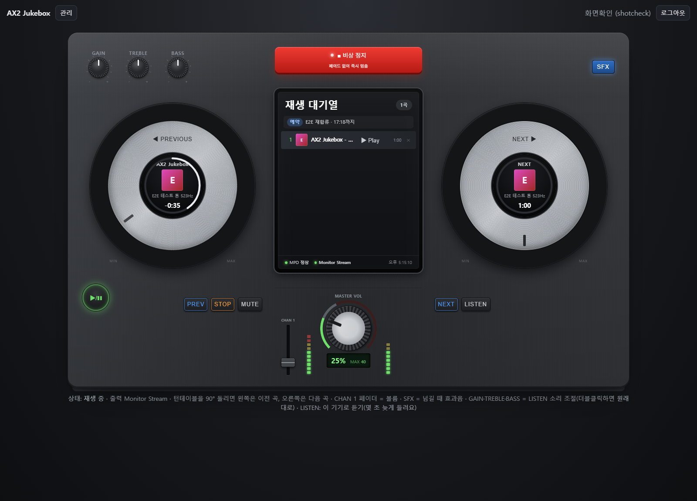
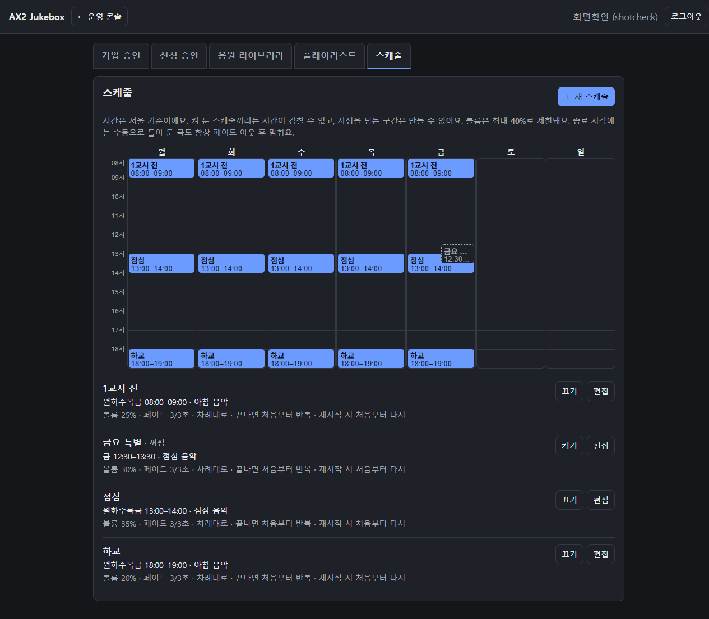
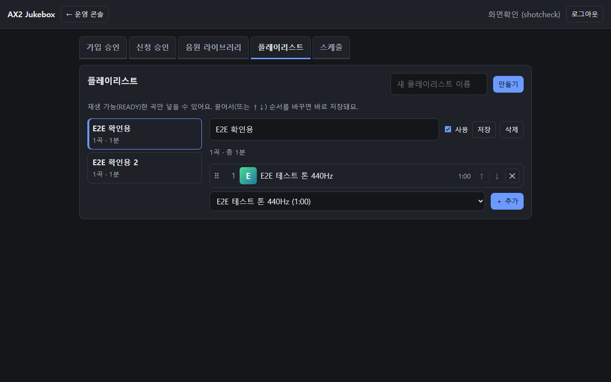
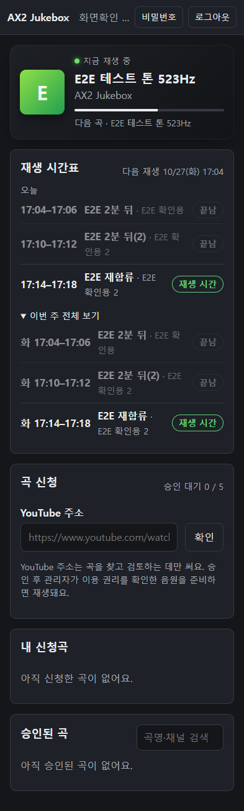

# STEP 03 결과 보고 — 플레이리스트·자동 스케줄·페이드·재합류

- 일자: 2026-10-20
- 범위: 요구사항 11장 3단계. FR-006(플레이리스트)·FR-007(자동 스케줄)·FR-011(시간 종료)·FR-015(스케줄 조회)·FR-019(수동 우선권), 4.1 스케줄 상세 규칙, 6장 데이터 모델, 10장 운영 정책
- 검증 환경: Windows 노트북의 `docker compose`(PostgreSQL 16·MPD httpd 출력·앱), 자동화 테스트는 `uv run pytest`(임시 PostgreSQL)

## 1. 구현 내용

| 영역 | 내용 |
|---|---|
| 데이터 | `playlists`, `playlist_items`(`UNIQUE(playlist_id, position) DEFERRABLE INITIALLY DEFERRED`), `schedules`(`weekdays smallint[]` ISO 1–7, `start_time < end_time`, 볼륨 0–100, 페이드 0–30초 기본 3, `rejoin_policy`·`playback_mode`·`on_playlist_end`·`is_enabled`·`timezone`), `playback_events`(trigger `SCHEDULE`/`MANUAL`/`REJOIN`). Alembic `d98c8df0034d`. 앱 시작 시 자동 적용 |
| 플레이리스트 API | 목록·상세(항목·총 길이·재생 불가 곡 수), 생성·수정·삭제, `PUT /items` 전체 순서 일괄 저장(한 트랜잭션). `READY` 아닌 곡 → 422 `TRACK_NOT_READY`, 스케줄이 쓰는 플레이리스트 삭제 → 409 `PLAYLIST_IN_USE` |
| 스케줄 API | 목록·생성·수정·삭제, `GET /api/schedules/upcoming`(오늘·이번 주·다음 재생). 켜 둔 스케줄끼리 같은 요일에 시간이 겹치면 409 `SCHEDULE_CONFLICT` + `conflicts`(맞닿는 끝·시작은 허용). 자정 넘김·역순 422. 볼륨은 0–100 저장, 상한(40)을 넘으면 `effective_volume`·`volume_clamped`로 알리고 재생 때 상한까지만 |
| 스케줄러 | APScheduler `BackgroundScheduler`를 앱 프로세스에 하나(워커 1개 전제), 2초마다 `ScheduleRunner.tick(now)`. MPD 명령은 모두 `PlayerController`를 통해서만. 시각은 주입(`clock`)해서 테스트는 고정 시각으로 검증 |
| 구간 시작·종료 | 시작: 플레이리스트의 `READY` 곡을 대기열에 올리고(섞기·반복 반영) 볼륨 0에서 스케줄 볼륨까지 페이드 인. 종료: 수동 조작 여부와 관계없이 **항상** 페이드 아웃 후 정지, 반복 해제, 볼륨은 원래 값으로 되돌림(다음 수동 재생이 무음이 되지 않게) |
| 페이드 | `PlayerController.fade_to(target, seconds)`: 0.2초 간격 단계적 `setvol`, 상한 적용. 수동 정지·볼륨·일시정지·비상 정지가 들어오면 그 자리에서 멈춤(수동 우선) |
| 재합류 | 앱을 켠 첫 tick이 구간 시작 30초 뒤 이후면 `rejoin_policy` 적용. `RESTART`는 처음부터 페이드 인(남은 시간 < `rejoin_min_remaining_seconds`(120초)면 합류 안 함 `TOO_LATE`), `SKIP`은 건너뜀. 결과를 `playback_events`와 로그에 남김 |
| 수동 우선권 | 구간 중 수동 정지·비상 정지 → 그 구간은 정지 유지. `resume_schedule`(콘솔 "▶ 예약 재개") 또는 다음 구간에서 재개. 구간 밖 수동 재생은 `manual_play_auto_stop_minutes`(30분) 뒤 자동 정지. 수동 재생 중 구간이 시작되면 예약 재생으로 바뀜 |
| 라이브러리 부족 | 재생 가능한 곡이 없거나 플레이리스트가 꺼져 있으면 재생하지 않고 정지 유지 + 콘솔 경고 + `NO_READY_TRACKS`/`PLAYLIST_INACTIVE` 기록. 편성 뒤 사용 불가가 된 곡은 재생 때 건너뜀 |
| 재생 현황 | `/api/player/status`에 `schedule`(재생 원인 `SCHEDULE`/`MANUAL`, 지금 구간, 다음 예약, `can_resume`, 경고). `/health/ready`에 스케줄러 상태 |
| 관리 화면 | **플레이리스트** 탭(곡 추가, 끌어서·↑↓ 순서 변경 즉시 저장, 총 길이, 재생 불가 곡 경고, 이름·사용·삭제), **스케줄** 탭(주간 시간표, 편집 폼: 요일·시각·플레이리스트·볼륨(상한 안내)·페이드·재생 순서·끝나면·재합류·사용, 겹침 시 충돌 블록을 빨갛게) |
| 운영 콘솔 | 대기열 화면 위 줄에 재생 원인(예약/수동/대기), 지금 구간과 종료 시각 또는 다음 예약, 경고, 수동 정지 후 "▶ 예약 재개" 버튼 |
| 학생 화면 | **재생 시간표**: 오늘 구간(재생 시간·예정·끝남), 이번 주 전체, 다음 재생 시각 |
| 유지 | 음원 라이브러리의 "대기열에 추가"는 수동 재생용으로 그대로 |

## 2. 자동화 테스트 — 145개 PASS

```
$ cd backend && uv run pytest -q
145 passed, 1 skipped in 33s
```

건너뛴 1개는 실제 `mpd` 바이너리가 있어야 도는 통합 테스트다. 테스트 DB는 `TEST_DATABASE_URL`(기본 `localhost:5432/jukebox_test`)로 지정한다.

새로 추가한 `tests/test_schedules.py`(24개). 시각은 `FixedClock`으로 고정하고 `runner.tick(시각)`을 직접 부른다.

| 항목 | 테스트 |
|---|---|
| 겹침 차단(수용 6) | 같은 요일 겹침 409 + 충돌 스케줄, 맞닿는 구간·다른 요일·꺼 둔 스케줄 허용, 켜거나 옮길 때 재검사 |
| 경계 시각(수용 5) | 07:59:59 정지 → 08:00:00 정각 재생(0→25 페이드 인 16단계) → 08:59:59 재생 유지 → 09:00:00 페이드 아웃(15단계) 후 정지, 볼륨 복원, 이벤트 `COMPLETED` |
| 재시작 재합류(수용 11) | 08:30 첫 tick → 닫히지 못한 기록은 `INTERRUPTED`, `REJOIN`/`PLAYING`, 08:58:01(남은 1분 59초) → `TOO_LATE`, `SKIP` → `SKIPPED`, 시작 30초 안 재시작은 정상 시작 |
| 수동 정지 후 유지 | 수동 정지 뒤 tick 해도 정지, `resume_schedule`로 재개, 다음 날 구간에서 자동 재생. 비상 정지도 유지. 구간 밖 `resume_schedule` 409 |
| 수동 재생 자동 정지 | 구간 밖 수동 재생 30분 뒤 정지(`MANUAL`/`AUTO_STOPPED`), 수동 재생 중 구간 시작 → 예약으로 전환 |
| 페이드 단계 | 10→30 1초 = 14·18·22·26·30, 상한 초과 목표는 40까지만, 페이드 중 수동 정지 시 즉시 중단 |
| 볼륨 상한 | 101은 422, 80은 저장되지만 `effective_volume` 40·재생도 40 |
| 플레이리스트 | READY 아닌 곡 422, 순서 뒤집기(DEFERRABLE), 총 길이, 사용 불가로 바뀐 곡 경고, 스케줄 참조 시 삭제 409 |
| 권한(수용 10) | 학생의 `resume_schedule`·플레이리스트·스케줄 변경 403, 조회는 200 |
| 기타 | 곡 없음 → 정지 유지·경고, 구간 중 스케줄 삭제 → 정지, `on_playlist_end=STOP`이면 반복 해제 |

## 3. Docker 확인 — 2분 뒤 시작하는 스케줄(수용 테스트 5)

화요일 17:10–17:12, 볼륨 30, 페이드 인·아웃 5초 스케줄을 17:07에 만들고 MPD 상태를 0.25초마다 읽었다(음원은 ffmpeg로 만든 사인파).

```
schedule 201  "E2E 2분 뒤(2)" 화 17:10–17:12
overlap  409  SCHEDULE_CONFLICT 다른 스케줄과 시간이 겹쳐요: 'E2E 2분 뒤(2)'(화 17:10–17:12)   ← 수용 6
17:09:54.334  start -5.67s  stop vol 30
17:10:00.612  start +0.61s  play vol 1      ← 정각 tick(최대 2초 간격) + 대기열 적재
17:10:01.866  start +1.87s  play vol 8
17:10:03.122  start +3.12s  play vol 16
17:10:04.379  start +4.38s  play vol 24
17:10:05.385  start +5.39s  play vol 30     ← 5초 페이드 인 완료
status@30s    {"cause": "SCHEDULE", "can_resume": false, "current": "E2E 2분 뒤(2)"}
17:12:00.663  end   +0.66s  play vol 28
17:12:02.168  end   +2.17s  play vol 19
17:12:03.675  end   +3.68s  play vol 10
17:12:05.182  end   +5.18s  play vol 1
17:12:05.433  end   +5.43s  stop vol 30     ← 페이드 아웃 후 정지, 볼륨은 원래 값으로
event SCHEDULE COMPLETED 17:10:00 17:12:00
```

**재시작 재합류(수용 11)** — 17:14–17:18 스케줄(볼륨 25) 중에 앱 컨테이너를 두 번 재시작했다.

```
17:14:45  docker compose restart app (재생 중 vol 25)
17:14:48  schedule rejoin schedule_id=3 result=RESTART remaining=191s
17:14:48  schedule start schedule_id=3 trigger=REJOIN … → 처음부터(song 0) 페이드 인 재생
17:16:42  다시 빌드·재시작(남은 시간 75초)
17:16:44  closed 2 playback event(s) interrupted by restart
17:16:44  schedule rejoin schedule_id=3 result=TOO_LATE remaining=75s   ← 2분 미만이면 합류하지 않음
17:18:02  schedule end schedule_id=3 → stop (종료 정지는 항상)

 trigger  | result      | 시작     | 종료
 SCHEDULE | INTERRUPTED | 17:14:00 | 17:16:44
 REJOIN   | INTERRUPTED | 17:14:48 | 17:16:44
 REJOIN   | TOO_LATE    | 17:16:44 | 17:16:44
```

`/health/ready` → `{"db": "ok", "mpd": "ok", "scheduler": "ok"}`. 확인에 쓴 스케줄·플레이리스트·음원·임시 계정은 모두 지웠다.

## 4. 화면

| 운영 콘솔(재합류 뒤 예약 재생 중) | 스케줄 탭(기본 시간표 예시, 꺼 둔 스케줄은 점선) |
|---|---|
|  |  |

| 플레이리스트 탭 | 학생 화면(휴대폰) |
|---|---|
|  |  |

## 5. 설계 메모

- **tick 방식**: 스케줄마다 cron 작업을 만들지 않고 2초마다 "지금 어느 구간인가"를 계산해 구간이 바뀔 때만 행동한다. 스케줄을 고치거나 지우면 다음 tick에서 바로 반영되고(구간이 사라지면 정지), 재시작 재합류도 같은 코드로 처리된다. 정시 시작은 최대 2초 늦을 수 있다.
- **구간 중에는 다시 시작하지 않는다**: 그래서 수동 정지·비상 정지 뒤에는 별도 플래그 없이 정지가 유지되고, 재개는 `resume_schedule`이나 다음 구간에서만 일어난다.
- **이벤트 기록**: 구간마다 한 줄. 앱이 구간 도중 꺼져 닫히지 못한 기록은 다음 시작 때 `INTERRUPTED`로 닫는다. 시작 때 `PLAYING`으로 남기고 종료 때 `COMPLETED`/`MANUAL_STOP`/`EMERGENCY_STOP`으로 닫는다. 재생 안 함(`NO_READY_TRACKS`·`SKIPPED`·`TOO_LATE`)도 남긴다. 곡별 재생 이력은 P1(FR-018).
- **타임존**: 저장은 서울 벽시계 시각(`time`) + `timezone`, 계산은 `zoneinfo`. 컨테이너·Windows 모두 동작하도록 `tzdata` 패키지를 넣었다. MVP는 `Asia/Seoul` 고정.

## 6. 발견한 문제와 조치

| 문제 | 조치 |
|---|---|
| 페이드(수 초) 동안 다음 tick이 건너뛰어지며 APScheduler가 2초마다 WARNING을 남김 | 정상 동작이라 `apscheduler` 로그를 ERROR 이상만 남김(작업 오류는 그대로 기록) |
| 구간 도중 재시작하면 그 구간의 기록이 `PLAYING`인 채로 남음 | 첫 tick에서 닫히지 않은 기록을 `INTERRUPTED`로 닫음(테스트 추가) |
| 예약으로 정지하면 볼륨 0이 남아 다음 수동 재생이 무음 | 정지 뒤 페이드 전 볼륨으로 되돌림 |
| 짧은 구간·꺼 둔 스케줄이 시간표에서 겹쳐 안 보임 | 45분 미만 블록은 이름만, 꺼 둔 스케줄은 칸의 오른쪽 반에 점선으로 |
| 학생 화면 "다음 재생 화 17:04"가 다음 주인데 오늘처럼 보임 | 7일 뒤부터는 `10/27(화) 17:04`처럼 날짜로 표시 |

## 7. 남은 일·주의

- 스케줄러는 앱 프로세스 안에 있어 **uvicorn 워커는 반드시 1개**(Dockerfile·systemd 설정 그대로 유지).
- 강의실 서버(ALSA 출력)에서 실제 앰프 소리로 드라이런 필요(11장 3단계 운영 정책).
- 휴강·공휴일 예외(`schedule_exceptions`), 곡별 재생 이력, SSE는 P1.
